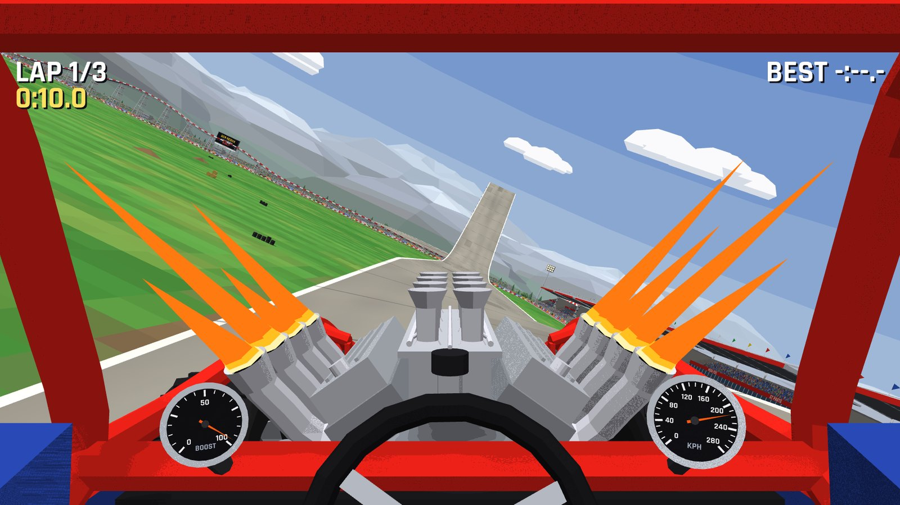
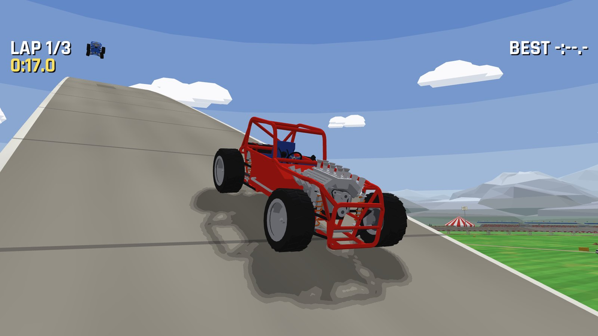
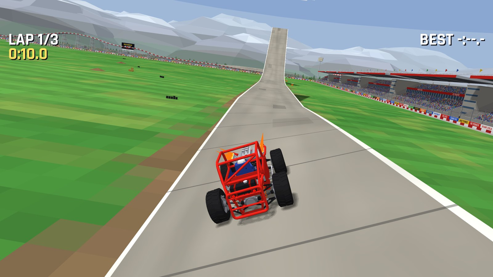
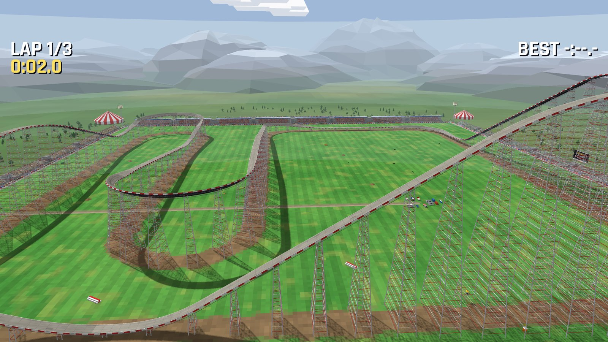
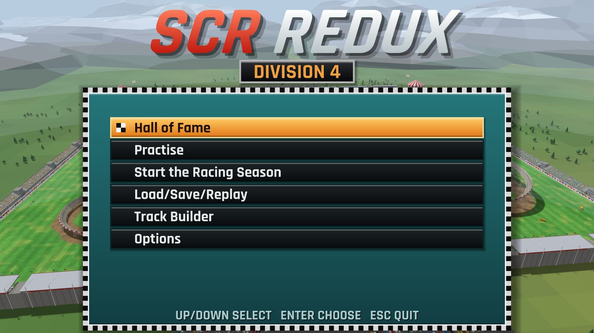
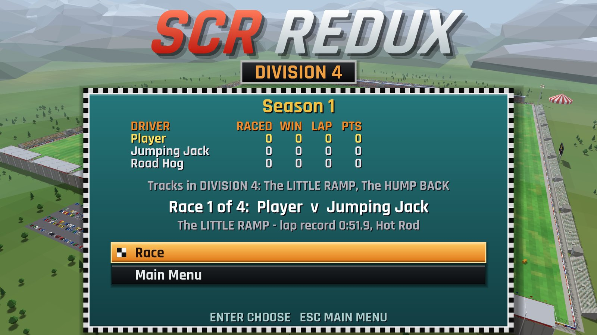
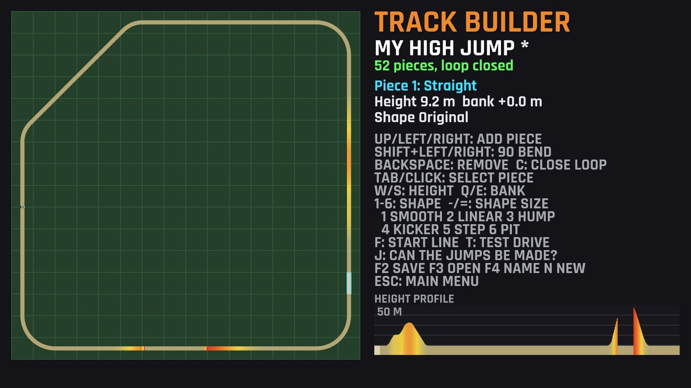
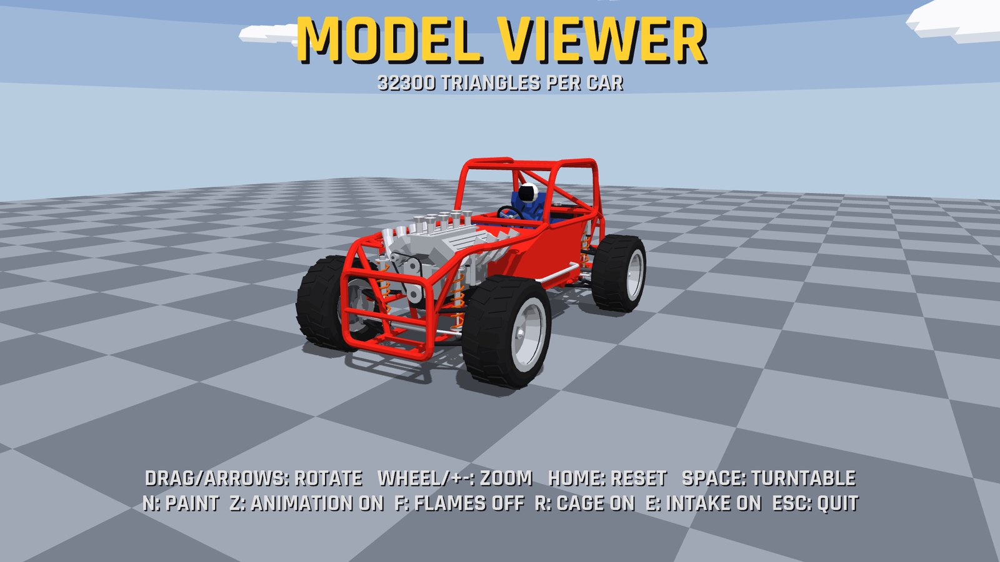

# SCR Redux

A remake-in-spirit of the Amiga classic *Stunt Car Racer* (SCR): race a V8 buggy round elevated roller-coaster tracks in
a stadium, take on eleven computer drivers in a four-division league, and build your own tracks.



## Screenshots

| | |
| --- | --- |
|  |  |
| Over the top of High Jump | The chase camera |
|  |  |
| Roller Coaster from above | The main menu |
|  |  |
| The Racing Season | The track builder, with High Jump open |
|  | |
| The model viewer | |

## Requirements

- SDL3
- A Vulkan-capable graphics driver (on macOS: MoltenVK)
- To build: a C compiler, `pkg-config` and `glslangValidator`

## Building and starting

```bash
make
```

```bash
./scrredux
```

Start the game from its own folder; it looks for its shaders, car model and sounds next to the binary.
Without the `sounds/` folder the game runs silently.

### Your files

Settings, seasons, the Hall of Fame, replays and your own tracks are kept in your user folder, not beside the game:

| System | Folder |
| --- | --- |
| macOS | `~/Library/Application Support/SCR Redux/SCR Redux/` |
| Windows | `%APPDATA%\SCR Redux\SCR Redux\` |
| Linux | `~/.local/share/SCR Redux/SCR Redux/` |

To keep everything somewhere else, a portable copy for instance, set `SCR_HOME` to a folder.

## Controls

| Key | Action |
| --- | --- |
| Up / W | Accelerate |
| Down / S | Brake |
| Left, Right / A, D | Steer |
| Space / Left Shift | Boost |
| R | Put the car back on the track |
| P / Esc | Pause menu: continue, restart (practice) or leave the race |
| F11 | Fullscreen |

In the menus: Up/Down or the number keys select, Enter confirms, Esc goes back. Esc in the main menu quits the game
(asks first). Retiring from a season race also asks first: you lose the race.

### Options

**Options** in the main menu sets the engine and effects volume, fullscreen and gamepad rumble; they are kept in
`options.txt` in your folder. **Driving keys** in there changes the driving keys: two keys each for accelerate, brake, steer
left, steer right and boost. Enter on a key, then press the new one; Del clears it. A key already in use swaps places
with the one it replaces. The keys are kept in `controls.txt`.

### Gamepad and joystick

Plug in a gamepad or joystick at any time.

| Gamepad | Action |
| --- | --- |
| Left stick, D-pad left/right | Steer (the stick steers part way) |
| Right trigger, A, D-pad up | Accelerate |
| Left trigger, X, D-pad down | Brake |
| Right shoulder, B | Boost |
| Y | Put the car back on the track |
| Start, Back | Pause menu |

The pad shakes on crashes, hits and hard landings (Options: gamepad rumble).

In the menus and the pause menu the D-pad or stick selects, A or Start confirms, B or Back goes back. The track
builder needs the keyboard and mouse; B or Back leaves it (twice with unsaved changes). In replays A pauses, Y changes the
camera and left/right winds back or forward.

A joystick SDL has no gamepad mapping for (a classic digital stick, say) steers with its stick or hat; forward
accelerates, back brakes and the first fire button boosts.

## Racing

You drive from the cockpit. The gauges on the roll cage beside the steering wheel show your speed and the boost you
have left. Damage shows as a crack growing along the top tube of the cage. When the crack reaches the right-hand end,
your car is wrecked. Heavy hits punch holes in the tube, starting at the right-hand end. The crack runs straight
through a hole, so every hole brings the wreck closer.

Fall off the track and a crane lifts you back on.

## Game modes

**Hall of Fame** – the best lap and best race time on every track, and who set them.

**Practise** – drive any track, the originals or your own, alone and for as many laps as you like. Esc ends the session.

**Racing Season** – the league. Twelve drivers in four divisions of three, two tracks per division:

| Division | Tracks |
| --- | --- |
| 4 | Little Ramp, Hump Back |
| 3 | Stepping Stones, Big Ramp |
| 2 | High Jump, Roller Coaster |
| 1 | Draw Bridge, Ski Jump |

You start in Division 4. Every driver races each of the other two on both tracks over three laps. A win is worth
2 points, the fastest lap 1. At the end of the season the top driver of each division moves up and the bottom one
moves down. The crack is mended after every race, but the holes stay until the season ends. There is room for ten;
once they are all punched, heavy hits make no more. Retiring from a race (Esc, then Y) hands the win to your
opponent. The season is saved automatically as you go.

**Load / Save / Replay** – four save slots for your season, and replays of your last five season races.
In a replay: C changes camera, Space pauses, hold Left/Right to rewind or fast-forward.

**Track Builder** – see below.

## Track Builder

Tracks are laid out from above on a 16 × 16 grid and grow from their open end. The outlines at the open end show
which pieces fit and which key adds them.

| Key | Action |
| --- | --- |
| Up | Add a straight |
| Left / Right | Add a 45° bend |
| Shift + Left / Right | Add a 90° bend |
| Backspace | Remove the last piece |
| C | Close the loop the shortest way |
| Tab / mouse click | Select a piece |
| W / S, mouse wheel | Raise / lower the start of the selected piece by 0.5 m (with Shift: 2 m) |
| Q / E | Bank the piece |
| 1 – 6 | Shape: smooth, linear, hump, kicker (jump), step, pit |
| - / = | Make a hump, kicker or pit smaller / bigger (a negative hump is a dip) |
| F | Put the start line on the selected straight |
| T | Test-drive the track |
| J | Check whether every jump can be made (impossible ones turn red) |
| F2 | Save |
| F3 | Open a track (the original tracks open as a copy) |
| F4 | Rename |
| N | Start a new track |

A drop of 3.7 m or more becomes a sheer wall, shown red on the map.

Your tracks are saved in `tracks/` in your folder and show up in Practise and the Hall of Fame. The Racing Season always uses the
eight original tracks.

## Car viewer

```bash
./scrredux --view
```

Drag the mouse or use the arrow keys to orbit, mouse wheel or +/- to zoom, Home to reset the view, Space to toggle
the turntable. N changes the paint, R hides the roll cage, E the intake, F toggles the exhaust flames.

## Development

How the game is built, and the debugging tools, are described in [DEVELOPING.md](DEVELOPING.md).

## Credits

The text font is [Rajdhani](https://fonts.google.com/specimen/Rajdhani) by the Indian Type Foundry, under the SIL Open
Font License.

The track layouts and sound effects come from the original *Stunt Car Racer* by Geoff Crammond, via the
[StuntCarRacer-X](https://github.com/Team-Resurgent/StuntCarRacer-X) remake.
